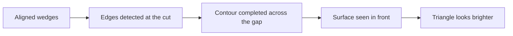

Look at the figure for a moment. Most people see a white triangle sitting on top of three black disks, and many describe it as slightly brighter than the page around it. There is no triangle. Nothing has been drawn along those edges.

> [!observation]
> Cover the disks with your fingers, one at a time. The edge nearest your finger tends to weaken first.

## A figure that completes itself

The arrangement is known as a Kanizsa figure, after the Italian psychologist Gaetano Kanizsa, who published a series of these displays in the 1950s.[^kanizsa] The wedges, often called *inducers*, are aligned so that their cut edges line up. The visual system treats that alignment as evidence of a shape lying in front, and fills in the rest.

> [!finding]
> Neurons in an early visual area, V2, have been recorded responding to illusory contours much as they respond to drawn ones.[^vdh]

That finding matters because it places some of the filling-in early in visual processing, not only in later interpretation. It does not mean the whole experience is explained there.

```vp-kanizsa
caption: Rotate the inducers. The edges vanish, then return when the wedges line up again.
```

The steps, as far as research can currently say:



## Why a designer should care

> [!speculation]
> If the eye completes shapes this readily, then a layout does not need to draw every edge. Alignment alone may be enough to make a group feel bounded.

That is a design idea, not a measured result. It is the kind of question this archive exists to test.

```vp-embed
name: illusory-square
height: 520
caption: Try it with four disks. Drag them until a square appears.
```

```vp-choice
question: Did the triangle look brighter than the page?
options:
  - Yes, clearly
  - A little
  - No difference
note: Your answer stays in this browser for now.
```

[^kanizsa]: Kanizsa, G. (1955). Margini quasi-percettivi in campi con stimolazione omogenea. *Rivista di Psicologia*, 49, 7–30.
[^vdh]: von der Heydt, R., Peterhans, E., & Baumgartner, G. (1984). Illusory contours and cortical neuron responses. *Science*, 224, 1260–1262.
